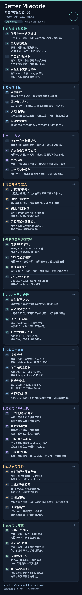

# Better Miacode

基于 [MiaCode](https://github.com/Team-MiaCode/MiaCode) 的谱面编辑器，以下仅列出 Better 的新增与改进。

最新发布：[2.0.1-better.11](https://github.com/albertoBradish/Better_Miacode/releases/tag/v2.0.1-better.11)。

[下载](https://github.com/albertoBradish/Better_Miacode/releases) · [对应源码](https://github.com/albertoBradish/Better_Miacode/tree/v2.0.1-better.11) · [English](README_EN.md) · [问题反馈](https://github.com/albertoBradish/Better_Miacode/issues)

功能快速查阅：
基于 MiaCode 的独立改进版本，保留原版的谱面编辑、实时预览、语法与无理检测、音视频工具、Net 谱面服务和封面制作等功能，并提供以下改进：

1. 点击源码行号快速定位到对应时间，并暂停播放；空行、注释行也可定位。
2. 支持播放选区片段，保留音符进场和长音符尾部，播放结束后自动暂停。
3. 预览和时间轴支持 Shift＋左键单击或拖框选择音符，可跨区域选择；再次命中已选音符可取消选择。选择音符时，现在可以将Slide与对应Star分开选择。（Updated）
4. 源码、时间轴和预览同步音符选择，并高亮对应音符，包括 Hold 身体、Slide 轨迹和移动星星。
5. 对象选择支持复制、剪切、粘贴、删除、镜像、旋转和属性变换，可直接使用编辑快捷键，并支持撤销、重做。
6. 复制音符片段时保留 BPM、分音、HS、拍号和中间空拍；粘贴自动对齐完整音符或拍首，并在片段结束后恢复目标谱面的时序设置。
7. 添加华卡风格的小节对齐参考线，支持按谱面 clock_count、自定义拍数或源码行首显示。
8. 支持显示 Slide 实际判定区骨骼，包含链式 Slide（FES） 和 WiFi 分路，并随判定进度消退。
9. 支持显示 Slide 判定时值：沿轨迹逐步恢复亮度，在最早可获得 Perfect 的时刻全亮，帮助观察实际判定窗口。Slide 判定时值支持“有启动拍时从启动拍开始”，并可选择“启动拍前已进入 Perfect 时，从头拍全亮”。
10. 宽屏画面支持分别显示 BPM、CPS、Meter 和 Mods；相关设置也可用于视频导出。
11. 支持 DX 达成率失分计算，统计各类物件数量、单次判定失分，以及维持 SSS／SSS+ 可容许的判定数量，包含 Break 细分判定和 EX 判定约束。（Updated）
12. 支持导出 BPM List，提供 BPM 顺序、音频时间和空 maidata 三种格式，可预览、复制或保存。空 maidata 保留 BPM、分音、显式拍号、偏移和源码结束拍位。
13. 视频导出可同步生成封面，支持选择内置封面模板、用户保存的模板和布局文件；单曲使用触发导出时的预览画面，批量任务使用模板保存的画面时间。允许多选导出。（Updated）
14. 封面文字支持描边和阴影，可调整颜色、宽度、透明度、模糊和偏移，并随布局保存、加载和复制。
15. 添加“无判定线”选项，可与小节参考线、判定骨骼等辅助显示分别控制。
16. 视频导出的 HUD、小节线、判定骨骼和 Slide 判定时值选项统一收纳在“更多显示”中，方便按需展开设置。
17. 支持通过 better-miacode 命令行查询谱面统计、列出封面模板、导出视频、封面和 BPM；支持 JSON 请求、进度和结果输出，方便批量处理。默认关闭，可于设置-关于中开启。
18. 打开文件时校验谱面格式，支持 .txt、.simai 和包含 maidata.txt 的文件夹，避免把其他类型文件误读为谱面。（已合并至官方Dev分支）
19. 使用独立的配置、缓存、会话和运行目录，与原版、手序版分别保存数据。可共存。
20. 添加高级信息编辑模式（默认关闭，在首选项-关于中打开）：此模式内谱面的&metadata会解锁更多编辑。默认关闭，可于设置-关于中开启。（New）
21. 允许对时间轴进行更细致的缩放：使用Alt+滚轮时可进行无极缩放。（Updated）
22. 添加drop/预览时间支持：可自动或手动选定谱面的Drop Time，此时间会在导出时作为默认的预览时间（可被部分支持的内容自动读取）/时间轴高亮/让🦊跳的更欢。（New）
23. 于首选项-性能中添加低性能模式，此模式下会优先保证60hz帧率与基础预览，尽可能降低程序占用与刷新。此选项更新后默认关闭。（New）
24. 于首选项-编辑器-输入中添加防空格误触功能：此功能开启的情况下，默认敲击空格会只保留“播放/暂停”逻辑。需短时间内连按3下空格才可解锁编辑器文本中的空格添加。编辑页面失焦后重新锁定。此选项默认开启。（New）
25. 于首选项-编辑器中添加可开启功能“自动整理谱面”：开启后，在打包.zip/渲染预览/首次打开一个未被打开过的maidata.txt时自动按照当前默认设置进行谱面整理。同时备份原maidata.txt至文件夹.autosave中，后缀改为.bak。此选项默认开启。（New）
26. 导出.zip时，若谱面有空难度则进行提示。此选项默认开启。（New）
27. 时间轴可以被纵向渲染（Visual Maimai Style）。（New）
28. 允许调整时间轴的行数渲染顺序，在默认的1-2-3-4-5-6-7-8之外添加。允许在首选项-界面-时间轴中选择其他排布：5-6-7-8-1-2-3-4 / 8-7-6-5-4-3-2-1 / 4-3-2-1-8-7-6-5。默认排布不变。（New）
29. 拓展了布局功能：现在可以自由排布工作区元素，导入、导出并保存模板。（New）
30. 新增一种视频导出-片头-片头样式：谱面预览。允许额外展示谱面预览时间。（New）
31. 重做了视频导出的文件体积设置：现在除了标准预设外，还有30MB/100MB/200MB/自定义预设，方便控制文件大小。在自定义模式下，可以手动输入期望码率。（New）
32. 视频导出-批量导出-输出文件夹现在默认为当前谱面的工作文件夹。（New）
33. 预览中会显示谱面热力图，提示谱面的密度结构。（New）
34. 编辑区的谱面整理按钮现在被替换为谱面信息按钮（因添加了自动整理）。（New）
35. 时间轴中的音符大小现在可被调整。（New）
36. 在常规与DJAUTO渲染的基础上添加了调试渲染：此渲染方式可显示额外谱面信息，同时不会渲染pv与曲绘，节省资源，同时方便按需作后期抠像处理。（New）
37. 🦊狐狸会跟着谱面节拍摇头、摆尾和轻弹身体，随 BPM、播放速度、暂停和时间跳转同步变化。在Drop Time时，还会有特殊动画。（Updated）
38. 修改了一些设计范式。
39. 更新了部分文本描述。
40. 移除了Him，加入了🦊。
    

## 对象选择与编辑

1. **行号定位与选区试听**：点击行号定位并暂停；试听选区时保留音符进场和长音尾部。
2. **三处联动选择**：源码、时间轴和预览同步选中音符；支持 Shift 框选，Slide 头星与轨迹可分别选中。
3. **非连续对象编辑**：对选中的音符执行复制、剪切、删除及已有变换，支持撤销、重做。
4. **保留上下文的剪贴板**：复制时保留 BPM、分音、HS、拍号和空拍，粘贴后恢复目标位置的时序。

## 时间轴增强

5. **连续缩放**：Alt＋滚轮无级缩放，保留原有自定义快捷键。
6. **独立音符大小**：音符可放大至 300%，与时间轴时间缩放分别调整。
7. **纵向时间轴**：置于编辑区左侧或右侧；可选上落、下落，播放线靠边。
8. **四种键位排列**：12345678／56781234／87654321／43218765。

## 自由工作区

9. **拖动停靠与标签组合**：面板可拖动重排、组合为标签页，单面板不重复显示标题。
10. **扩展面板浮动与显隐**：编辑器、大纲、时间轴、语法和无理面板可分别浮动或隐藏。
11. **命名布局**：保存、切换和重置工作区，布局预设统一放在“工作区”菜单。
12. **工作区快捷操作**：Alt＋W 打开菜单；反引号最大化、还原当前模块。

## 判定辅助与渲染

13. **小节对齐参考线**：支持默认检测、自定义拍数和源码行首三种模式。
14. **Slide 判定骨骼**：显示实际判定区，覆盖链式 Slide 与 WiFi 分路。
15. **Slide 判定时值**：最早 Perfect 时全亮；支持启动拍规则，保留正常轨迹消退。
16. **黑底调试与图层控制**：黑底调试和无判定线模式；调试设置不影响常规渲染。

## 预览信息与谱面资料

17. **信息 HUD 扩展**：BPM、CPS、Meter、Mods 分别开关，预览适配自由比例。
18. **CPS 与显示精简**：同拍 Touch 在 CPS 中按组计数；预览画布不重复显示下方已有的物量统计。
19. **高级信息表单**：填写各类 ID、版本、定数、试听区间、日期和作者备注。
20. **DX 失分与容错**：计算 SSS／SSS+ 可容许的失分和 Tap Great 数量，计入 Break／EX 约束。

## Drop 与压力分析

21. **自动推荐 Drop**：结合音频与谱面分析，推荐预览区间。
22. **手动设定与取消**：拖动调整区间，或从源码选区右键设置、取消；支持撤销和重做。
23. **保存并联动导出**：区间保存至 maidata，优先使用人工选择；进度条标记、片头和导出区间共用。
24. **可定位的压力热图**：综合位移、动作上下文和耐力估算压力，留白处归零；点击或拖动热图可定位。

## 视频导出增强

25. **视频模板**：保存、应用、重命名与导入导出；使用 .miatemplate，兼容旧 JSON。
26. **体积与码率控制**：30／100／200 MB 预设或自定义 Mbps，PV 可独立开关。
27. **新增分辨率**：支持 360p、480p、540p 和 4K，适用于现有三种导出画幅。
28. **谱面预览片头**：左侧信息卡、右侧谱面，沿用预览背景设置，不显示编辑辅助。

## 封面与 BPM 工具

29. **一次同步多张封面**：组合使用内置、用户及布局模板；批量导出默认保存到当前谱面目录。
30. **封面文字效果**：描边与阴影可调整颜色、宽度、透明度、模糊和偏移。
31. **BPM 导入与应用**：导入音频时间列表或空 maidata，预览后应用；保留音符时间，支持撤销。
32. **三种 BPM 导出**：顺序、音频时间、空 maidata；可预览、复制和保存。

## 编辑流程保护

33. **自动整理与原文备份**：首次打开 maidata、打包 ZIP 或生成视频前自动整理，原文件备份至 .autosave。
34. **空难度导出提醒**：打包 ZIP 时提醒空难度，默认取消导出；可在首选项关闭提醒。
35. **空格防误触**：单按播放／暂停，短时连按三次后可输入空格，编辑器失焦后重新锁定。
36. **低性能模式**：优先 60 Hz 基础预览，减少界面特效及播放中的时间轴刷新。

## 使用与可靠性

37. **Better 命令行**：运行统计、视频、封面和 BPM 任务，支持 JSON 请求与进度输出。
38. **独立运行数据**：配置、缓存、会话与日志独立保存，不迁移原版或手序版数据。
39. **狐狸律动升级**：非 Drop 段眨眼、随拍摇头；Drop 段闭眼跳跃，动画平滑衔接。
40. **导出与保存修正**：修复尾帧丢失和 CRLF 保存误判；失败或取消保留已有输出。

查看完整更新长图

## 使用

Windows 包完整解压到可写目录后，从根目录 `MiaCode.exe` 启动。更新时保留 `runtime/`；其他平台以 Release 附件为准。

在首选项“关于”启用命令行集成后，可使用 `better-miacode`。自动整理、空格防误触和空难度提醒默认开启；高级信息编辑和低性能模式默认关闭。

预览支持自由比例；视频预设为 1:1、4:3、16:9，命令行导出的视频宽度不能小于高度。压力估算供编排参考，不等同于官方定数。

Better Miacode 不包含手序标注或自动手序拆解功能。

## 来源与许可

本项目不是 Team-MiaCode 官方发行版。代码采用 GPLv3，第三方许可与致谢见 `LICENSE`、`THIRD_PARTY_NOTICES.md` 和 `ACKNOWLEDGEMENTS.md`。
