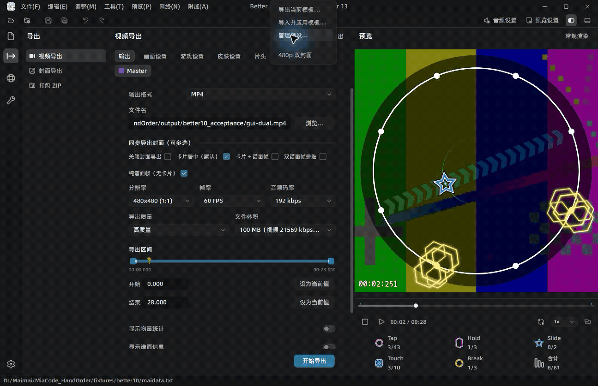
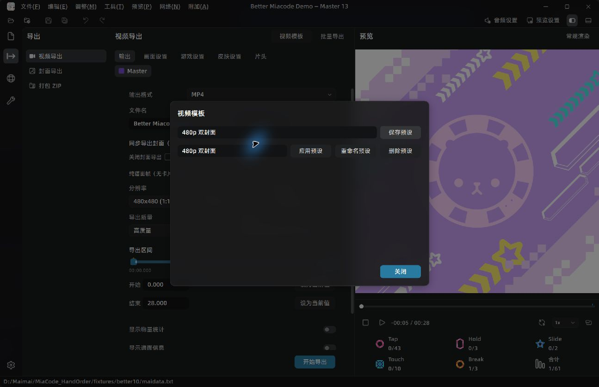
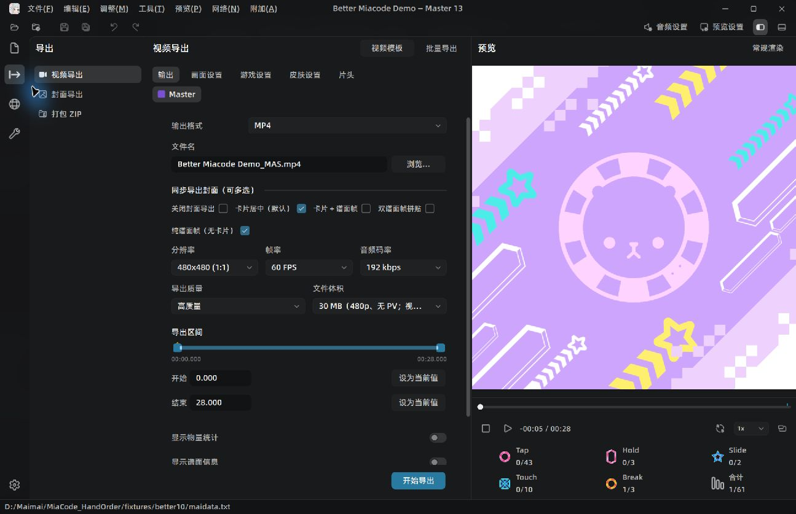
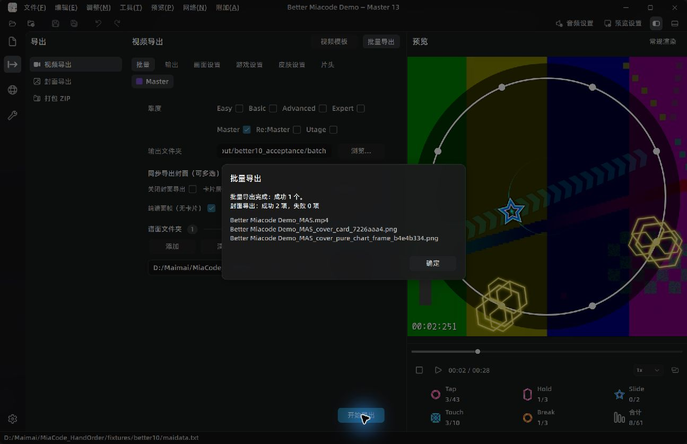
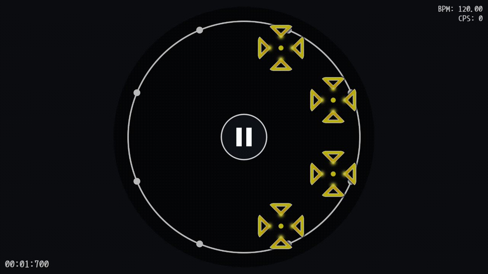
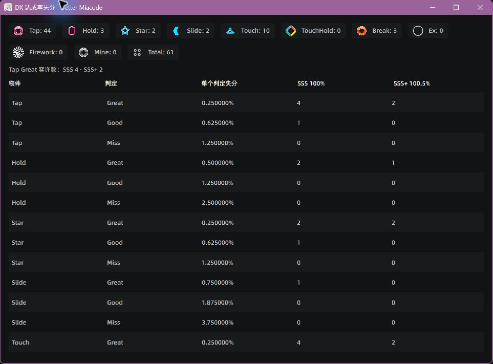
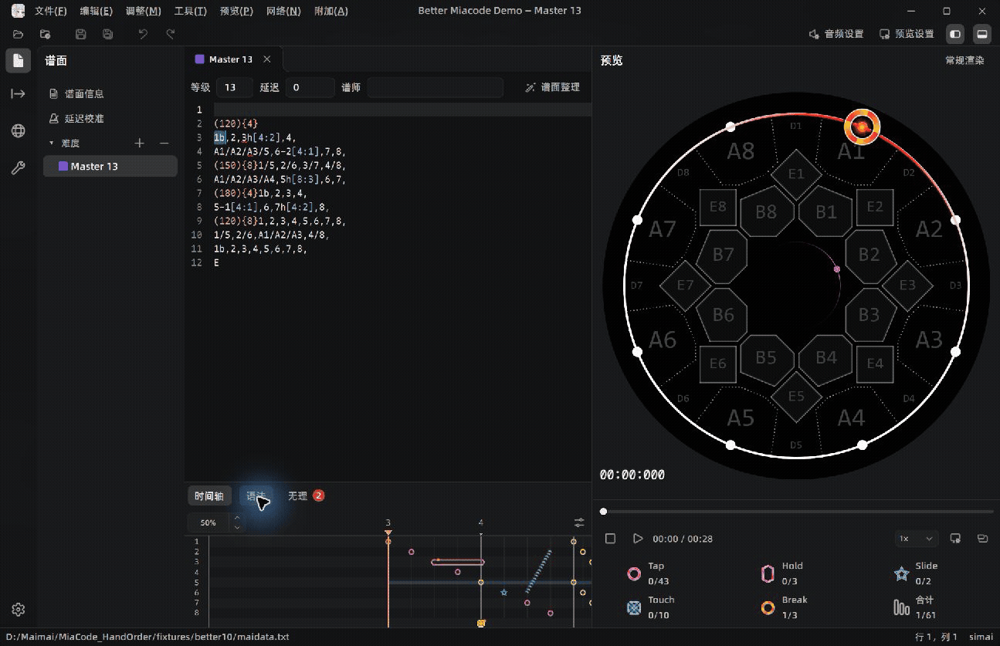
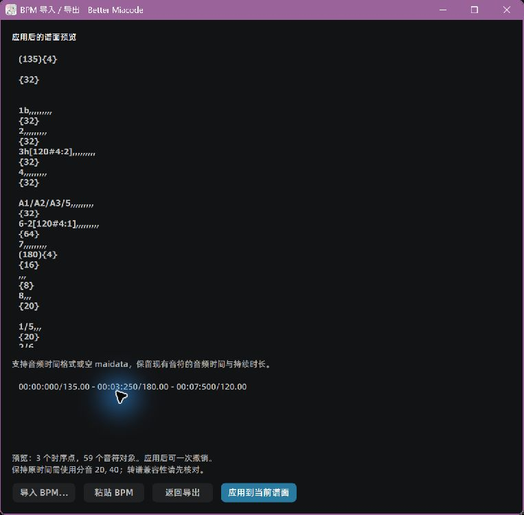
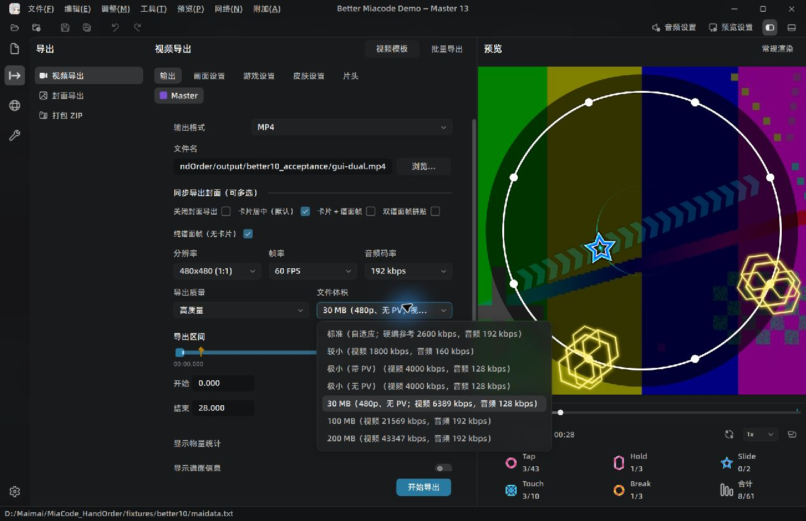
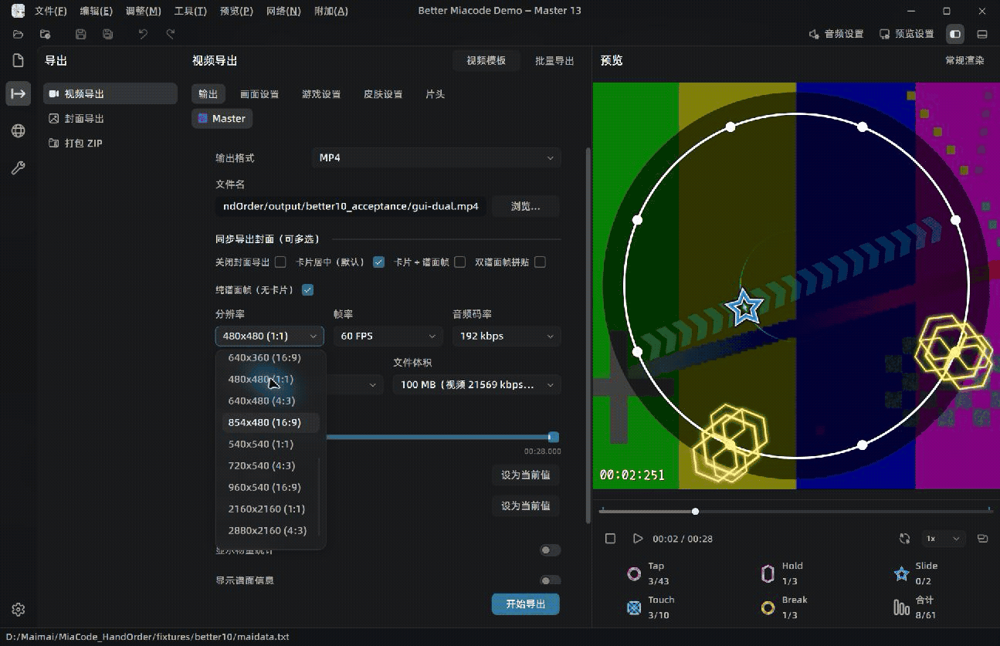

# Better Miacode

基于 [Team-MiaCode/MiaCode](https://github.com/Team-MiaCode/MiaCode) 的独立 maimai 谱面编辑器，重点改进音符编辑、判定辅助、视频导出和封面制作。

当前开发版本为 **2.0.1-better.11.dev.3**，基于官方 [dev](https://github.com/Team-MiaCode/MiaCode/commit/be494a567869b407fd17acad33482af6ad1c664d)。Better Miacode 使用独立配置，不包含手序版或自动手序实验代码。

[下载已发布版本](https://github.com/albertoBradish/Better_Miacode/releases) · [问题反馈](https://github.com/albertoBradish/Better_Miacode/issues)

## 功能一览

基于 MiaCode 的独立改进版本，保留原版的谱面编辑、实时预览、语法与无理检测、音视频工具、Net 谱面服务和封面制作等功能，并提供以下改进：

1. 点击源码行号快速定位到对应时间，并暂停播放；空行、注释行也可定位。

2. 支持播放选区片段，保留音符进场和长音符尾部，播放结束后自动暂停。

3. 时间轴支持 Alt＋鼠标滚轮连续缩放，音符大小可独立调整至 300%，兼容已有的自定义缩放快捷键。

4. 预览和时间轴支持 Shift＋左键单击或拖框选择音符，可跨区域选择；Slide 头星与轨迹可独立选中，再次命中已选音符可取消选择。

5. 源码、时间轴和预览同步音符选择，并高亮对应音符，包括 Hold 身体、Slide 轨迹和移动星星。

6. 对象选择支持复制、剪切、粘贴、删除、镜像、旋转和属性变换，可直接使用编辑快捷键，并支持撤销、重做。

7. 复制音符片段时保留 BPM、分音、HS、拍号和中间空拍；粘贴自动对齐完整音符或拍首，并在片段结束后恢复目标谱面的时序设置。

8. 添加华卡风格的小节对齐参考线，支持默认自动检测、自定义拍数或源码行首显示。

9. 支持显示 Slide 实际判定区骨骼，包含链式 Slide 和 WiFi 分路，并随判定进度消退。

10. 支持显示 Slide 判定时值：沿轨迹逐步恢复亮度，在最早可获得 Perfect 的时刻全亮，帮助观察实际判定窗口。

11. 可在首选项中设置 Slide 判定时值的启动拍规则，以及“启动拍前已进入 Perfect 时，从头拍全亮”。

12. 预览与视频导出可分别显示 BPM、CPS、Meter 和 Mods，支持方形、竖屏及自由比例画面。

13. 支持 DX 达成率失分计算，统计各类物件数量、单次判定失分，以及维持 SSS／SSS+ 可容许的判定数量，包含 Break 细分判定和 EX 判定约束。

14. 支持导入音频时间格式或空 maidata 并应用 BPM，保留音符起止时间且可撤销；导出提供 BPM 顺序、音频时间和空 maidata 三种格式。

15. 视频导出可同步生成多张封面，支持内置模板、用户模板和布局文件；批量输出默认使用当前谱面目录。

16. 封面文字支持描边和阴影，可调整颜色、宽度、透明度、模糊和偏移，并随布局保存、加载和复制。

17. 添加“无判定线”选项，可与小节参考线、判定骨骼等辅助显示分别控制。

18. 视频导出的 HUD、小节线、判定骨骼和 Slide 判定时值选项统一收纳在“更多显示”中，方便按需展开设置。

19. 支持通过 better-miacode 命令行查询谱面统计、列出封面模板、导出视频、封面和 BPM；支持 JSON 请求、进度和结果输出，方便批量处理。

20. 打开文件时校验谱面格式，支持 .txt、.simai 和包含 maidata.txt 的文件夹，避免把其他类型文件误读为谱面。

21. 使用独立的配置、缓存、会话和运行目录，与原版、手序版分别保存数据。

22. 🦊狐狸在 Drop 段闭眼跟拍跳跃，其余段落轻摇头、摆尾并自然眨眼，随播放平滑变化。

23. 时间轴支持横向、编辑区左侧或右侧的纵向布局，可选择上落、下落及四种键位排列；默认与语法、无理共用编辑区下方的标签栏，也可独立停靠。

24. “工作区(W)”统一管理布局预设、面板显隐、拖动停靠和独立浮窗；支持命名布局及反引号键最大化、还原模块，左侧导航栏保持固定。

25. 支持高级谱面信息表单，可填写歌曲与谱师 ID、分类、版本、定数、试听区间和作者备注；可从编辑器头部直接打开谱面信息。

26. 结合音频与谱面自动推荐 Drop 区间，支持手动调整、选区右键设置或取消，并保存至 maidata；预览进度条、时间轴和视频导出共用该区间。

27. 预览底部显示谱面压力热图，综合密度、位移、连续动作上下文和耐力负荷；按实际触击与长音区间绘制，留白归零，支持点击或拖动定位。

28. 提供黑底调试渲染，常规模式始终隐藏判定标记和触摸轨迹；小节线、判定骨骼和 Slide 时值统一在预览显示选项中设置。

29. 视频片头支持“谱面预览”：左侧信息卡、右侧谱面，沿用预览的背景明暗、缩放与皮肤，并隐藏编辑辅助信息。

30. 视频模板支持保存、应用、重命名和导入导出，使用 `.miatemplate` 后缀，兼容旧 JSON 模板。

31. 视频提供标准、30 MB、100 MB、200 MB 体积预设及自定义目标码率，PV 可独立开关；分辨率覆盖 360p 至 4K。

32. 支持首次打开 maidata、打包 ZIP 和渲染前自动整理谱面，原文件备份至 `.autosave/*.bak`。

33. 默认启用空格防误触：单按播放或暂停，短时间内三连按解锁文本空格，编辑器失焦后重新锁定。

34. 提供低性能模式，优先保障 60 Hz 基础预览，减少播放中的时间轴刷新和界面特效。

35. 打包 ZIP 时可提示空难度，默认取消，可在首选项中关闭提醒。

下载与反馈：
[GitHub Releases](https://github.com/albertoBradish/Better_Miacode/releases) · [问题反馈](https://github.com/albertoBradish/Better_Miacode/issues)

本版默认界面字体使用阿里巴巴普惠体，字体许可随程序提供。操作细节见 [功能说明](docs/BETTER_MIACODE_ZH.md)。

<details>
<summary>better.10 功能演示</summary>

以下图片和动图对应 better.10 的界面。

### 1. 视频导出模板

在视频导出页打开“视频模板”，可保存和选择预设、重命名、删除，以及导入、导出模板文件。模板保留分辨率、帧率、质量、体积、显示、皮肤和片头等设置；应用时保留当前谱面、输出路径及导出区间。



<details>
<summary>查看模板管理界面</summary>



</details>

### 2. 一次导出多张封面

“同步导出封面”改为复选，支持内置模板、用户模板和布局文件，单曲及批量导出均可使用。多张封面按模板分别命名；已有同名文件时生成新文件名。修复关闭封面导出时显示翻译键名的问题。



<details>
<summary>查看同一次导出的两张封面与批量结果</summary>

| 卡片封面 | 谱面帧封面 |
| --- | --- |
|  |  |



</details>

### 3. Touch 同时计数

同一时间的一组 Touch 在 CPS 中只计一次。预览和导出共用计算规则，谱面物件数量和计分统计保持各自的统计方式。下例同时击中四个 Touch，HUD 显示 CPS 1。



### 4. 失分统计精简

隐藏 Tap Perfect 等零失分判定及无法发生的判定行。顶部直接显示达到 SSS、SSS+ 时可容许的 Tap Great 数，按完整分数预算折算；详细表保留各类判定的单次失分与可容许数量。无 Break 谱面的 SSS+ 显示为不可达。



### 5. BPM 导入、应用与撤销

“工具 → BPM 导入 / 导出”支持导入或粘贴音频时间格式和空 maidata。应用前显示重建后的谱面预览，并核对语法、物件及时间。已有音符保留相对音频的起止时间，Hold 和 Slide 的持续时长一并保留；空谱生成时间骨架。

应用仅修改当前难度，作为一次编辑支持撤销和重做。准备期间若切换或修改谱面，会拒绝使用过期结果。保留原时间若需要非 384 分音，会在应用前提示转谱兼容性。



<details>
<summary>查看 BPM 应用预览</summary>



</details>

### 6. 按目标文件体积导出

新增 **30 MB、100 MB、200 MB** 三档，MB 按 1,000,000 字节计算。码率计入片头、进场预卷、音频和封装开销，完成后按实际文件大小检查；超限时调整码率重新编码，通过检查后才写入最终文件。

30 MB 档自动使用 480p、关闭 PV，并保留所选画幅比例。原有体积档位在括号内显示视频与音频码率；标准档注明自适应及硬件编码参考值。体积上限约束 MP4，单独导出的 WAV 仍为无损音频。



### 7. 更多分辨率

新增 **360p、480p、540p、4K（2160p）**，覆盖 1:1、4:3、16:9。16:9 对应 640×360、854×480、960×540 和 3840×2160；已有 720p、1080p、1440p 设置继续可用。



[查看原尺寸 4K 导出帧](resources/demos/better10/4k-frame.png)

</details>

## 开始使用

- Windows：完整解压发行包，从根目录 `MiaCode.exe` 启动。运行数据保存在包内独立的 `runtime/`。
- Apple 芯片 macOS：使用对应 Release 的 `MiaCode.app`；独立数据目录为 `~/Library/Application Support/BetterMiacode`。平台适用版本和验证范围见对应发布说明。
- 不自动迁移原版或手序版的偏好、最近文件和恢复内容。

## 命令行

在“设置 → 关于”启用命令行集成后，重新打开终端使用 `better-miacode`。

```sh
better-miacode --version
better-miacode stats --chart maidata.txt --difficulty 5 --json
better-miacode presets list --json
better-miacode export video --chart maidata.txt --difficulty 5 --output out.mp4 --width 1920 --height 1080 --size-preset 30mb --json
better-miacode export cover --chart maidata.txt --output cover.png --preset builtin:card --time 12.5
better-miacode export bpm --chart maidata.txt --output bpm.txt --format audio-time
```

`--size-preset` 支持 `standard`、`30mb`、`100mb`、`200mb`、`custom`；自定义码率使用 `--video-bitrate`，关闭 PV 使用 `--no-pv`。已有输出需显式提供 `--overwrite`。视频与封面渲染需要可用的图形环境和媒体依赖。

结构化请求沿用 schemaVersion 1：

```json
{
  "schemaVersion": 1,
  "command": "export",
  "type": "video",
  "chart": "maidata.txt",
  "difficulty": 5,
  "output": "out.mp4",
  "size-preset": "100mb"
}
```

使用 `better-miacode --request request.json` 执行。请求文件内相对路径以该文件目录为基准；`--json`／`--ndjson` 渲染输出为逐行进度和最终结果。

## 构建与验证

构建依赖和脚本见 [scripts/README.md](scripts/README.md)。使用 Release，并发上限 4。GUI、CLI 和 worker 需使用独立且有标记的 `BETTER_MIACODE_RUNTIME_ROOT`。

开发版功能见 [更新说明](docs/releases/workflow_dev_20261108.md)；历史版本见 [better.10](docs/releases/better_10.md)、[better.9](docs/releases/better_9.md) 与 [better.8](docs/releases/better_8.md)。

## 授权

项目代码采用 [GPLv3](LICENSE)。第三方许可见 [THIRD_PARTY_NOTICES.md](THIRD_PARTY_NOTICES.md)，贡献与致谢见 [ACKNOWLEDGEMENTS.md](ACKNOWLEDGEMENTS.md)。
