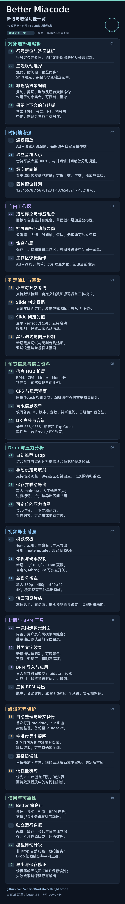

# Better Miacode

An independent enhancement fork of [MiaCode](https://github.com/Team-MiaCode/MiaCode). The list below covers only Better Miacode additions and improvements.

**Current version: 2.0.1-better.11.**

[Published releases](https://github.com/albertoBradish/Better_Miacode/releases) · [Issues](https://github.com/albertoBradish/Better_Miacode/issues)

## Selection & editing

1. **Line navigation and selection playback.** Jump from line numbers and pause, including blank/comment lines; play selections with note lead-in and long-note tails.

2. **Linked object selection.** Synchronize source, timeline, and preview selections; Shift-select visible objects, with separate Slide heads and tracks.

3. **Non-contiguous object editing.** Apply copy, cut, delete, and existing transforms to selected note objects without changing intervening notes; undo each operation.

4. **Context-aware note clipboard.** Preserve BPM, subdivisions, HS, meter, and rests; align pasted fragments and restore the destination timing context.

## Timeline enhancements

5. **Continuous zoom.** Zoom continuously with Alt+wheel while retaining existing custom shortcuts.

6. **Independent note size.** Enlarge note symbols up to 300%, independently of the time scale.

7. **Vertical timeline.** Place it beside either edge of the editor, choose falling or rising flow, and keep the playhead near the corresponding edge.

8. **Four lane orders.** Choose 12345678, 56781234, 87654321, or 43218765.

## Workspace controls

9. **Docking and tab groups.** Rearrange and group panels without adding duplicate headings to single panels.

10. **More detachable panels.** Manage the editor, outline, timeline, syntax, and Muri panels independently, including visibility and floating windows.

11. **Named layouts.** Save, switch, and reset named workspaces, with layout presets in one menu.

12. **Workspace shortcuts.** Open Workspace with Alt+W; maximize or restore the active panel with the backtick key.

## Visual aids & rendering

13. **Measure guides.** Choose automatic detection, custom beats per measure, or source line starts.

14. **Slide judgement skeletons.** Display judgement regions for chained Slides and WiFi branches.

15. **Slide judgement timing.** Reveal tracks by the earliest Perfect instant, with launch-beat options and native track erasure.

16. **Debug rendering and layer controls.** Add black-background debug rendering and no-guide mode, with debug settings isolated from normal rendering.

## Preview information & metadata

17. **Additional HUD information.** Toggle BPM, CPS, meter, and mods independently, with arbitrary-aspect preview layouts.

18. **CPS and cleaner previews.** Count simultaneous Touch groups once in CPS and remove duplicated object statistics from the editor canvas.

19. **Advanced metadata forms.** Edit IDs, version, level constants, demo windows, dates, and creator comments in dedicated fields.

20. **DX score-loss allowances.** Calculate SSS/SSS+ budgets and Tap Great allowances, including Break details and EX constraints.

## Drop & pressure analysis

21. **Drop recommendations.** Analyze audio and chart data to suggest preview regions.

22. **Manual region editing.** Adjust regions, set them from source selections, clear them, and undo or redo edits.

23. **Persistent regions.** Save regions in maidata, prioritize manual choices, and share them across markers, intros, and export ranges.

24. **Seekable pressure heatmap.** Estimate movement, context, and sustained effort; keep rests at zero and click or drag to seek.

## Video export enhancements

25. **Video templates.** Save, apply, rename, import, and export .miatemplate files with legacy JSON compatibility.

26. **Size and bitrate control.** Add 30/100/200 MB targets, custom Mbps, and an independent PV switch.

27. **More resolutions.** Add 360p, 480p, 540p, and 4K across the existing export aspect ratios.

28. **Chart-preview intro.** Place the information card beside the chart, inherit normal preview backgrounds, and hide editing overlays.

## Covers & BPM tools

29. **Multiple companion covers.** Combine built-in, saved, and layout presets; batch output defaults to the current chart directory.

30. **Cover text effects.** Add configurable outlines and shadows, including color, width, opacity, blur, and offsets.

31. **BPM import and application.** Import audio-time lists or empty maidata, preview the result, preserve note timing, and undo changes.

32. **Three BPM export formats.** Preview, copy, or save ordered BPM values, audio-time lists, and empty maidata.

## Editing workflow safeguards

33. **Automatic formatting and backups.** Format on first maidata open, ZIP packaging, and rendering, with original-file backups in .autosave.

34. **Empty-difficulty warning.** Warn before ZIP packaging charts with empty difficulties; default to Cancel, with a preference to disable the warning.

35. **Spacebar guard.** Use a single press for playback; triple-press to unlock text spaces and relock when focus leaves the editor.

36. **Low-performance mode.** Prioritize basic 60 Hz preview and reduce effects and automatic timeline updates during playback.

## Automation & reliability

37. **Better command line.** Run statistics, video, cover, and BPM tasks with JSON requests and progress output.

38. **Isolated runtime data.** Keep settings, caches, sessions, and logs separate from upstream MiaCode and HandOrder.

39. **Fox rhythm animation.** Blink and nod outside Drop regions; dance with closed eyes during Drop, with smooth transitions.

40. **Export and save fixes.** Fix lost final frames and CRLF save checks; preserve existing output on failure or cancellation.

Shareable update image

## Use

Extract the complete Windows package to a writable folder and launch the root `MiaCode.exe`. Keep the isolated `runtime/` directory when updating. Available platform packages are listed with each release.

Enable command-line integration in Preferences → About before using `better-miacode`. The spacebar guard, automatic formatting, and empty-difficulty warning are enabled by default; advanced metadata and low-performance mode are opt-in.

Preview supports arbitrary aspect ratios. Video presets remain 1:1, 4:3, and 16:9; command-line video width must be at least its height. Pressure is an estimate, not an official level constant.

Better Miacode contains no hand-order annotation or automatic hand-order inference features.

## License

Based on Team-MiaCode/MiaCode; this is not an official Team-MiaCode release. Code uses GPLv3. See `LICENSE`, `THIRD_PARTY_NOTICES.md`, and `ACKNOWLEDGEMENTS.md` for licenses and credits.
